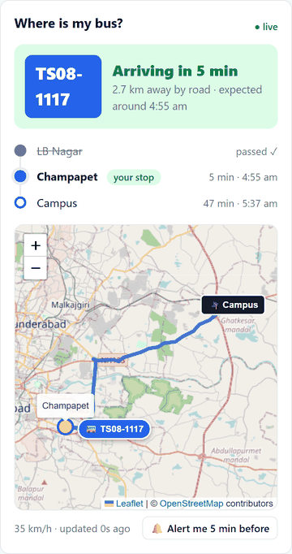
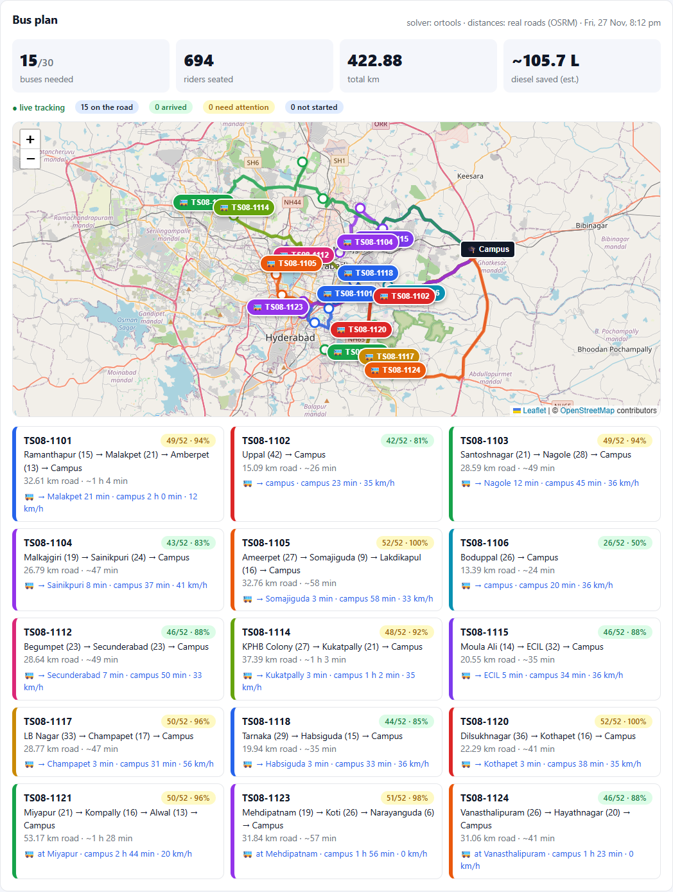
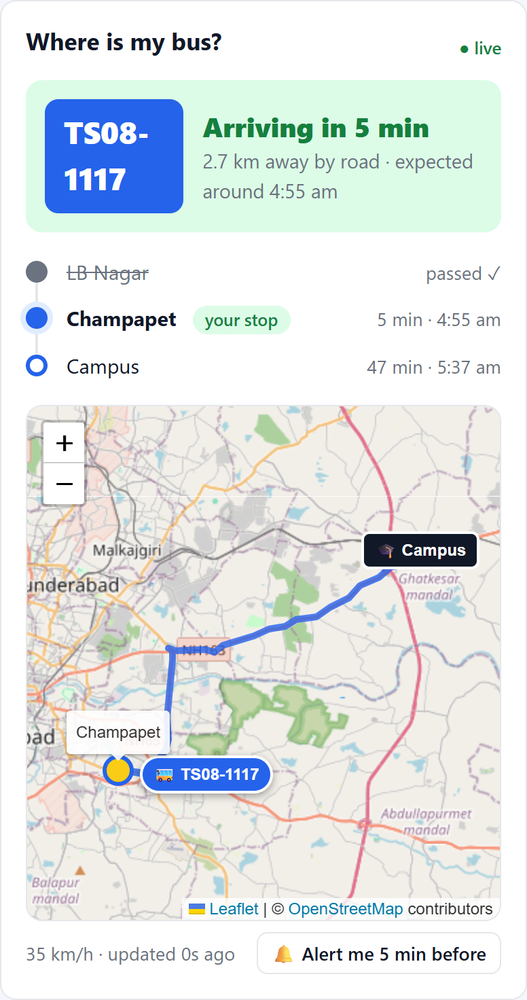
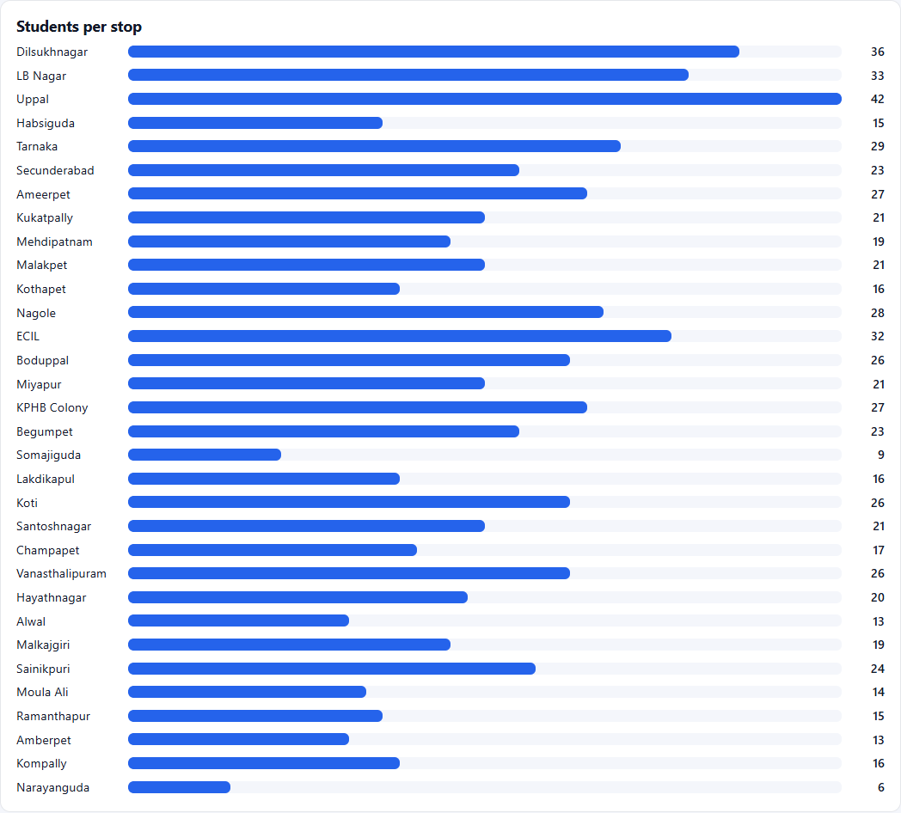
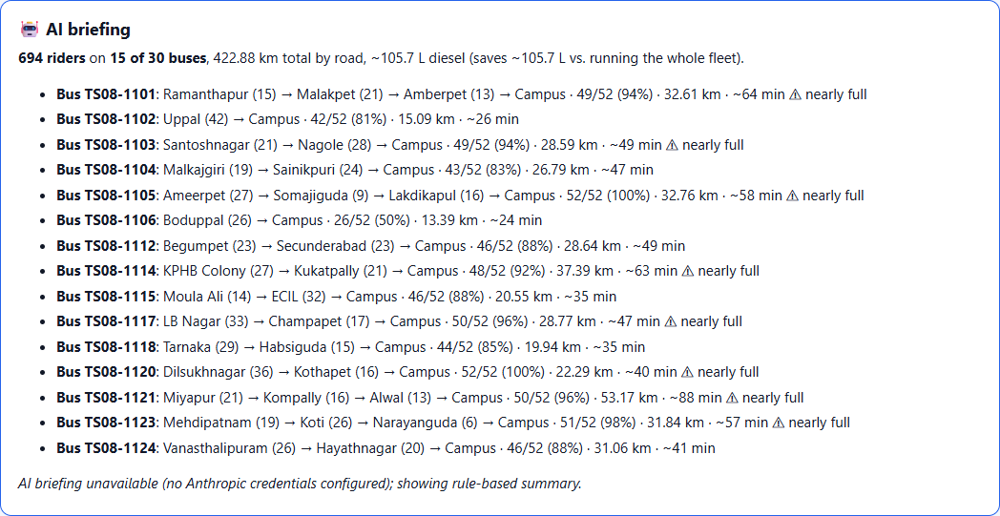
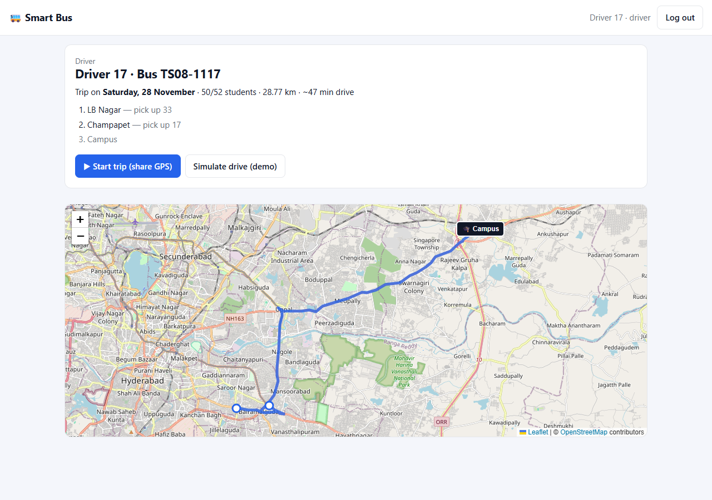
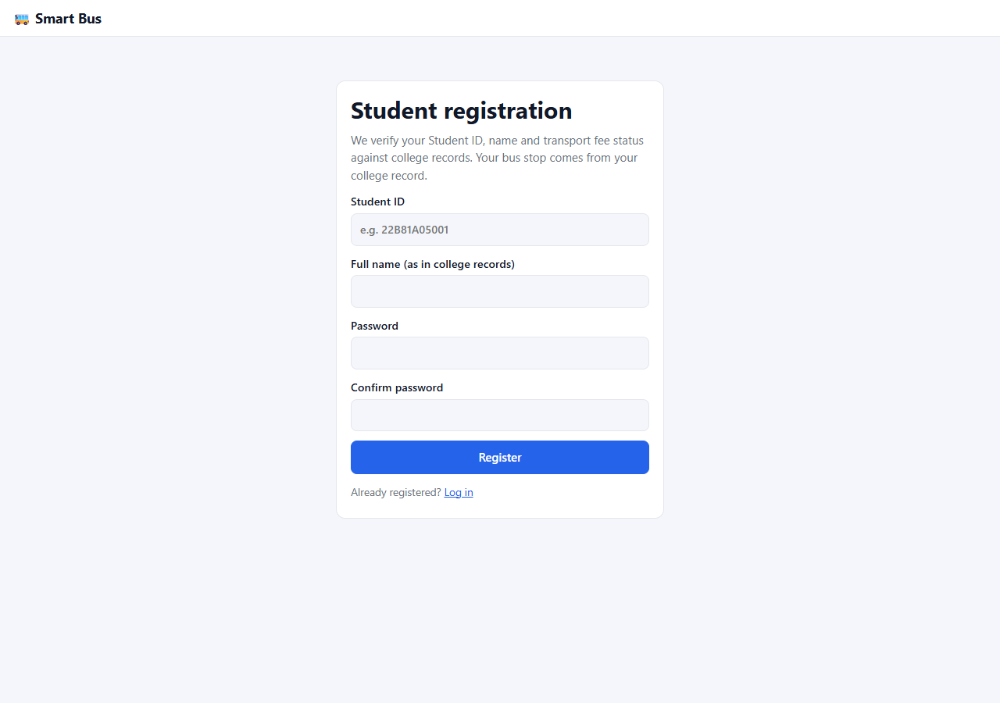

# Smart Bus — demand-based college bus planning

Students vote each evening whether they'll take the bus tomorrow. When voting closes, a routing
agent combines stops into the **fewest buses that fit everyone without exceeding any bus's seats**,
assigns every student to a specific bus, and that student can then **track their bus live**.

**Live demo:** https://smart-bus-48vw.onrender.com. Log in as `admin` / `admin123`, a driver
(`driver1` / `driver123`) or any pre-registered student (`student123`). The free plan sleeps when
idle, so the first load can take about 30 s. Demo data resets on every restart.

## Screenshots

<p align="center">
  
</p>

| Admin: routes planned and live fleet | Student: where is my bus? |
|---|---|
|  |  |

| Students per stop (votes) | AI briefing for the admin |
|---|---|
|  |  |

| Driver: route and GPS sharing | Registration checked against college records |
|---|---|
|  |  |

## How it works

```
Student registers ──► verified against college DB (ID + name + transport fee paid)
        │
Voting window (e.g. 6–9 pm) ──► student taps Yes / No  (stop comes from college record)
        │
Admin closes voting ──► "Plan routes & assign buses"
        │
   ┌────┴──────────────── Agent ─────────────────────────┐
   │ 1. OR-Tools CVRP solver                              │
   │    • demand per stop = Yes votes                     │
   │    • hard seat limit per bus                         │
   │    • fixed cost per bus → combines stops, fewer buses│
   │    • big stops split across buses; max route length  │
   │ 2. Seat assignment: each Yes voter → one bus         │
   │ 3. Claude (claude-opus-5-5) writes a briefing:       │
   │    fuel saved, near-full buses, risks, suggestions   │
   └──────────────────────────────────────────────────────┘
        │
Driver opens driver page ──► phone GPS sent every few seconds
        │
Student sees their bus, stop order and live location on the map
```

## Run it (development)

Requirements: Python 3.11+, Node 18+.

```bash
# backend  (http://localhost:8000, API docs at /docs)
cd backend
python -m venv .venv
.venv\Scripts\activate          # macOS/Linux: source .venv/bin/activate
pip install -r requirements-dev.txt   # requirements.txt alone is enough to run the app
uvicorn app.main:app --reload --port 8000

# frontend (http://localhost:5173)
cd frontend
npm install
npm run dev
```

Demo data is created automatically on first start (14 stops in Hyderabad, 420 students, 10 buses,
and an open voting window). Reset it with `python -m app.seed --reset` (from `backend/`).

| Role    | Login                         | Password     |
|---------|-------------------------------|--------------|
| Admin   | `admin`                       | `admin123`   |
| Driver  | `driver1` … `driver10`        | `driver123`  |
| Student | any pre-registered Student ID | `student123` |

**Try the full flow:** log in as admin → *Simulate student votes* → *Close voting now* →
*Plan routes & assign buses*. Then log in as a student to see their bus, and in another browser
as that bus's driver → *Simulate drive* to watch the bus move on the student's map.

### Production-style single server

```bash
cd frontend && npm run build      # FastAPI serves frontend/dist automatically
cd ../backend && uvicorn app.main:app --host 0.0.0.0 --port 8000
```

## Fee payments and savings

- **Students** can register even if their transport fee is pending. They can pay from the
  dashboard and get a printable receipt, but they can't book a seat until the fee is paid.
  Checkout is a **demo**: no real money moves and no payment details are collected. At setup, a
  real gateway (for example Razorpay or Cashfree, settling into the college's account) replaces
  it, and the fee is then marked paid only after the gateway's signed confirmation.
- **Admins** get a Payments tab (paid and pending students, money collected, recent payments) and
  a Savings tab. Every planned trip records the diesel and money saved compared with the college's
  old way of running a fixed number of buses daily. The tab also shows the **platform fee**, a
  configurable % of savings, which is what the college pays for the service. Demo history is
  included so the page isn't empty before a pilot, and the admin can clear it with one click.

## Live bus tracking

- The driver page sends phone GPS (`navigator.geolocation`). The server snaps each fix onto the
  planned road path ([tracking.py](backend/app/tracking.py)) and works out the bus's progress,
  smoothed speed, which stops are passed, and an ETA for every stop.
- Updates are pushed instantly over WebSockets ([hub.py](backend/app/hub.py)): students get
  only their own bus, and admins get the whole fleet.
- Students see "Arriving in 7 min · 3.1 km away", a stop timeline, the driven part of the route
  in grey, and an optional alert 5 min before arrival.
- The app flags buses that leave the planned route or lose GPS signal, and ignores very poor
  GPS fixes. A fix can't move the bus further along the route than it could physically have driven.
- **Real phones:** run `npm run dev:https` in `frontend` and open `https://<PC-IP>:5173` on the
  driver's phone on the same Wi-Fi. Accept the certificate warning, then allow location access.

## Simulation and test data

```bash
cd backend
python -m app.seed --reset --scale large    # 32 stops, 1500 students, 30 buses
# start the server, then in the admin page: simulate votes, close voting, plan routes
python simulate_buses.py --speedup 10 --detour 21 --dropout 0.05 --noise 10
```

The simulator drives every planned bus along its real road route, with traffic jams, stopping
time at stops, GPS jitter, signal dropouts and an optional detour. `--speedup` runs trips faster
than real time; speeds and ETAs are then reported in simulated time.
`python demo_browser.py <shots_dir>` clicks through the whole app in visible Edge windows.

## Deploy (Render, free)

The repo is ready for [Render](https://render.com): `Dockerfile` builds the frontend and backend
into one service, and `render.yaml` describes it.

1. On render.com, choose **New → Blueprint** and pick this repository.
2. Optionally, add `ANTHROPIC_API_KEY` in the service's Environment tab to turn on AI briefings.
3. Every push to `main` redeploys automatically. Day-to-day work happens on `dev`, and
   `main` is updated only when something is ready.

On the free plan the service sleeps when idle, so the first visit takes about 30 s, and demo data
is re-created on every restart.

## AI briefing (optional)

Set `ANTHROPIC_API_KEY` before starting the backend. Without it, the app still works and shows a
rule-based summary instead. The planner itself never depends on the AI: seat limits are enforced
by the solver. Server-side refusal fallback (`fallbacks: "default"`) is enabled on the request.

## Connecting the real college database

All college data access goes through [backend/app/college_db.py](backend/app/college_db.py).
Write a class with `lookup(student_id)` and `all_students()` that queries the real system
(MySQL/Postgres/ERP API), and return it from `get_directory()`. Nothing else changes.
The fee status is re-checked at every vote, so a student whose fee lapses can't book a seat.

## Configuration (env vars)

| Var | Default | Meaning |
|---|---|---|
| `CAMPUS_LAT` / `CAMPUS_LNG` | 17.45 / 78.68 | Where every route ends |
| `BUS_FIXED_COST_KM` | 40 | How strongly to prefer fewer buses (km-equivalent per bus) |
| `MAX_ROUTE_KM` | 75 | Longest route one bus may drive |
| `ROAD_FACTOR` | 1.35 | Straight-line → road distance multiplier |
| `BUS_KM_PER_LITRE` | 4.0 | For fuel estimates |
| `JWT_SECRET` | random, stored in `data/` | **Set in production** |
| `ADMIN_PASSWORD` / `DRIVER_PASSWORD` | demo values | **Change in production** |
| `CLAUDE_MODEL` | claude-opus-5-5 | Model for the briefing |

## Notes and limits

- **Real roads:** distances, route shapes and drive times come from OSRM (OpenStreetMap routing),
  see [roads.py](backend/app/roads.py). Results are cached in `data/road_cache.json`. If OSRM is
  unreachable, it falls back to straight-line × `ROAD_FACTOR` and the admin page says so.
  The default server is the free public OSRM demo, which is for light use only. For production,
  self-host OSRM with the India/Telangana OSM extract and set `OSRM_URL`. Set
  `ROUTING_PROVIDER=straight` to work offline.
- Phone browsers only share GPS over **HTTPS** (or `localhost`). Deploy behind HTTPS for drivers.
- Live tracking uses 5-second polling; switch to WebSockets if you have hundreds of watchers per bus.
- Planned for the morning (stops → campus). The evening trip is the same plan reversed.

## Tests

```bash
cd backend && pytest
```

## License

[MIT](LICENSE)
